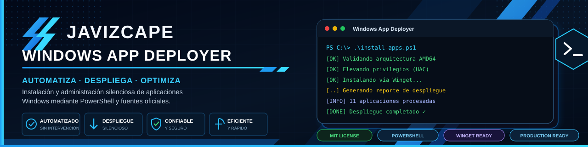
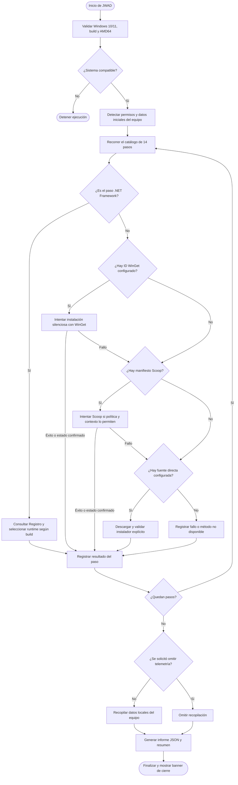

<div align="center">



<br>

[](LICENSE)
[](#-requisitos)
[](#-ejecución-rápida)
[](#-cómo-funciona)

[](../../stargazers)
[](../../network/members)
[](../../commits/main)
[](../../issues)

**Un solo comando. Un equipo Windows completamente listo para producción.**

[Instalación rápida](#-ejecución-rápida) •
[Características](#-características-principales) •
[Software incluido](#-software-incluido) •
[Reporte JSON](#-reporte-json-y-telemetría) •
[Contribuir](#-contribuciones)

</div>

---

# 🚀 EJECUCIÓN RÁPIDA

<p align="left">
  
  
  
</p>

**¿Solo necesitas ejecutar JWAD?** Abre PowerShell en Windows 10/11 de 64 bits, utiliza uno de los comandos siguientes y deja que el script procese su catálogo de aplicaciones.

### Método 1 — PowerShell (recomendado)

1. Pulsa **Inicio**, escribe `PowerShell` y abre **Windows PowerShell** o **PowerShell 7**.
2. Copia, pega y presiona **Enter**:

**Windows 10 / 11 (x64):**

```powershell
irm https://javizcape.github.io/JWAD/JWAD.ps1 | iex
```

**Alternativa** cuando `irm` no consigue descargar el archivo, pero `curl.exe` sí tiene acceso al sitio:

```powershell
iex (curl.exe -s https://javizcape.github.io/JWAD/JWAD.ps1 | Out-String)
```

> **Importante:** ambos comandos descargan el script desde GitHub Pages y lo ejecutan en la sesión de PowerShell. La alternativa con `curl.exe` no evita un bloqueo del dominio o de DNS: utiliza la misma dirección. Antes de ejecutar código remoto, revisa el [script JWAD.ps1 en GitHub](https://github.com/javizcape/JWAD/blob/main/JWAD.ps1).

### Método 2 — Descargar, revisar y ejecutar localmente

El propio script recomienda revisar el archivo antes de ejecutarlo. Este método permite inspeccionar el código primero:

```powershell
$scriptPath = Join-Path $env:TEMP 'JWAD.ps1'
Invoke-WebRequest -Uri 'https://javizcape.github.io/JWAD/JWAD.ps1' -OutFile $scriptPath
notepad $scriptPath
```

Después de revisar y cerrar el Bloc de notas, ejecuta:

```powershell
& $scriptPath
```

> **Permisos:** JWAD **no se autoeleva ni vuelve a abrir PowerShell mediante UAC**. Detecta el contexto de administrador y continúa; sin elevación, la actualización de .NET Framework puede quedar como fallida cuando sea necesaria. Si vas a ejecutar JWAD para instalar o actualizar ese componente, abre PowerShell **como administrador** antes de empezar. El bootstrap de Scoop tiene una protección adicional: si la consola está elevada, no lo instala como administrador salvo autorización explícita mediante `JWAD_ALLOW_SCOOP_ADMIN=1`.

---

## 📌 Tabla de contenidos

- [Ejecución rápida](#-ejecución-rápida)
- [¿Qué es JWAD?](#-qué-es-jwad)
- [Requisitos](#-requisitos)
- [Características principales](#-características-principales)
- [Cómo funciona](#-cómo-funciona)
- [Software incluido](#-software-incluido)
- [Validación de descargas](#-validación-de-descargas)
- [Reporte JSON y telemetría](#-reporte-json-y-telemetría)
- [Resumen de consola y registros](#-resumen-de-consola-y-registros)
- [Parámetros y personalización](#-parámetros-y-personalización)
- [Seguridad y permisos](#-seguridad-y-permisos)
- [Preguntas frecuentes](#-preguntas-frecuentes)
- [Hoja de ruta](#-hoja-de-ruta)
- [Contribuciones](#-contribuciones)
- [Licencia](#-licencia)
- [Autor](#-autor)

---

## 🧭 ¿Qué es JWAD?

**JWAD (Windows App Deployer)** es un script de automatización desarrollado en PowerShell. Su versión adjunta en este proyecto es la **3.2.5** y organiza la preparación de un equipo Windows x64 en **14 pasos**: 13 aplicaciones de uso general y una comprobación/instalación específica de .NET Framework.

Para cada aplicación, JWAD utiliza una estrategia de instalación escalonada: **WinGet → Scoop → descarga directa verificada**. No todos los programas tienen configurada cada una de esas fuentes; el script solo intenta un método cuando el catálogo contiene los identificadores, manifiestos o datos de descarga necesarios. Si una vía no está configurada o falla, puede probar la siguiente que sí esté definida.

Además de instalar, el script detecta aplicaciones existentes, compara versiones en los casos implementados, registra los intentos y genera un informe JSON local con resultados y datos del equipo. La recopilación de telemetría es opcional.

---

## ✅ Requisitos

- **Sistema operativo:** Windows 10 o Windows 11 de escritorio, arquitectura **x64 / AMD64**.
- **Compilación mínima:** Windows build **10240** o posterior. El script valida que sea un sistema cliente Windows 10/11; no está configurado para ARM64 ni para Windows Server.
- **PowerShell:** Windows PowerShell **5.1** o PowerShell **7 o superior**.
- **Conectividad:** acceso a Internet para consultar catálogos, manifiestos, APIs y descargar instaladores cuando sea necesario.
- **WinGet:** se utiliza como primera vía cuando está instalado y el paquete tiene un ID configurado, pero **no es un requisito obligatorio**. Scoop y las descargas directas son rutas de respaldo para los programas que las tienen configuradas.
- **Permisos administrativos:** no son exigidos de forma global por el lanzador, pero sí pueden ser necesarios para instaladores concretos. La instalación/actualización de .NET Framework exige una consola elevada cuando la versión instalada no alcanza el mínimo requerido.

---

## 🛠️ Características principales

| Característica | Funcionamiento comprobado en el script |
|---|---|
| **Estrategia escalonada de instalación** | Intenta WinGet, luego Scoop y finalmente una fuente directa cuando cada método está configurado para la aplicación. |
| **Instalación silenciosa** | Utiliza opciones no interactivas de WinGet y argumentos silenciosos específicos para los instaladores EXE/MSI configurados. La interacción externa de Windows, UAC o políticas del equipo puede seguir siendo necesaria. |
| **Detección de instalaciones existentes** | Consulta claves de desinstalación de Windows y, para Scoop, su lista o estructura de carpetas. Compara versiones donde existe información suficiente. |
| **Prevención de instalaciones duplicadas** | Cuando una aplicación existente no se puede validar o está administrada por Store/políticas, conserva el estado detectado en vez de ejecutar automáticamente un instalador alternativo que pueda interferir. |
| **Validación de fuentes directas** | Exige HTTPS, una selección explícita del archivo y un SHA-256 o firmante Authenticode esperado; también comprueba la cabecera de archivos EXE/MSI. |
| **Tratamiento de errores** | Captura códigos de salida, tiempos de espera, intentos y errores por aplicación. Los resultados de una aplicación no impiden registrar los siguientes pasos. |
| **Gestión específica de Edge** | Consulta la API oficial de Microsoft para la versión Stable x64 y respeta las políticas detectadas de actualización/canal. |
| **Gestión específica de FlyPhotos** | Comprueba compatibilidad y versiones, distingue la edición de Microsoft Store de la MSI de GitHub y evita sustituir una edición Store por otra distinta. |
| **.NET Framework según Windows** | Lee la compilación del sistema y el valor `Release` del Registro para elegir el instalador compatible y evitar reinstalar una versión suficiente. |
| **Registro y diagnóstico local** | Crea un log de ejecución, un informe JSON y una tabla final con estado, método, versión y duración por aplicación. |
| **Consola con identidad JWAD** | Presenta un banner ASCII de inicio, datos del equipo, avance de los 14 pasos, resumen final y banner de cierre con el sitio del proyecto. |

> **Alcance de la automatización:** que una instalación se ejecute en modo silencioso no significa que cualquier equipo pueda completar todos los pasos sin intervención. La disponibilidad de red, los permisos, las políticas corporativas, el estado previo de Windows y las fuentes de paquetes influyen en el resultado.

---

## ⚙️ Cómo funciona

El flujo general de la versión 3.2.5 es el siguiente:



### Secuencia de instalación por aplicación

1. **WinGet:** si el catálogo contiene un `WingetId`, intenta instalar en modo silencioso y arquitectura x64. Comprueba los códigos de salida y, en ciertos casos, confirma la presencia de la aplicación en el Registro o mediante `winget list`.
2. **Scoop:** solo se intenta si WinGet no resolvió el paso y existe un nombre de paquete configurado. Puede utilizar una instalación previa de Scoop o intentar su bootstrap bajo las condiciones de seguridad descritas más adelante. Los buckets previstos en el catálogo son `main`, `extras` y `java`.
3. **Descarga directa:** se ejecuta únicamente cuando existe una URL, página, manifiesto JSON o release de GitHub aprobado para esa aplicación. La selección del archivo utiliza patrones específicos; no escoge arbitrariamente el primer EXE/MSI de una página o release.
4. **Registro:** guarda el método utilizado, el estado, la versión detectada, el tiempo, los intentos y los detalles disponibles. Continúa con el siguiente elemento del catálogo.

La fase de **.NET Framework** es independiente de la cadena WinGet/Scoop: consulta el Registro y selecciona el runtime objetivo según la compilación de Windows. Si ya hay una versión suficiente, la registra como presente; si necesita instalarla, utiliza un instalador de Microsoft y valida su firma Authenticode.

### Versiones de .NET Framework seleccionadas

| Compilación de Windows detectada | Objetivo configurado por JWAD |
|---|---|
| 10240 a 14392 | .NET Framework 4.6.2 |
| 14393 a 19041 | .NET Framework 4.8 |
| 19042 o posterior | .NET Framework 4.8.1 |

La versión se determina mediante el número de compilación y el valor `Release` del Registro. No es una instalación de .NET moderno (.NET 6, 8, etc.); el paso se refiere expresamente a **.NET Framework 4.x**.

---

## 📦 Software incluido

El catálogo contiene los siguientes **14 pasos**. La disponibilidad de una aplicación y la versión final dependen de la fuente que JWAD pueda utilizar en ese equipo.

#### 🧩 Componentes y entornos de ejecución

| Aplicación | Detalle del catálogo |
|---|---|
| **Visual C++ Redistributable x64** | Microsoft Visual C++ 2015–2022 Redistributable para 64 bits. |
| **Eclipse Temurin 21 JRE** | Entorno de ejecución Java 21 de 64 bits. |
| **.NET Framework Runtime** | Selecciona .NET Framework 4.6.2, 4.8 o 4.8.1 de acuerdo con la compilación de Windows. |

#### 🧰 Compresión y mantenimiento del sistema

| Aplicación | Descripción |
|---|---|
| **7-Zip** | Compresión y descompresión de archivos. |
| **WinRAR x64** | Gestión de archivos comprimidos; la ruta directa identifica la sección estable en inglés de RARLAB. |
| **Bulk Crap Uninstaller** | Desinstalación de aplicaciones y gestión de desinstalaciones por lotes. |

#### 🌐 Navegadores web

| Aplicación | Descripción |
|---|---|
| **Microsoft Edge** | Navegador de Microsoft; el flujo especial comprueba la versión Stable x64 y las políticas de actualización. |
| **Google Chrome** | Navegador de Google. |
| **Mozilla Firefox** | Navegador de Mozilla; el idioma de descarga puede definirse mediante `JWAD_FIREFOX_LOCALE` (por defecto, `en-US`). |
| **Mullvad Browser** | Navegador del proyecto Mullvad; la ruta directa utiliza releases de su repositorio oficial de GitHub. |

#### 🎬 Documentos, imágenes y multimedia

| Aplicación | Descripción |
|---|---|
| **SumatraPDF** | Lector ligero de documentos PDF y otros formatos compatibles. |
| **VLC Media Player** | Reproductor multimedia. |
| **FlyPhotos** | Visor de imágenes; JWAD comprueba la compatibilidad del sistema y diferencia la edición Store de la instalación MSI. |

#### 🔌 Descargas

| Aplicación | Descripción |
|---|---|
| **AB Download Manager** | Administrador de descargas. |

---

## 🔐 Validación de descargas

La ruta de descarga directa no consiste en descargar cualquier archivo que aparezca en una página. El catálogo define el origen y el patrón de nombre que debe coincidir; JWAD exige una coincidencia única cuando resuelve assets de páginas o releases.

Entre los controles implementados se encuentran:

- **HTTPS:** rechaza URLs directas que no utilicen HTTPS.
- **Selección explícita:** usa IDs, manifiestos, endpoints del proveedor o expresiones regulares específicas para identificar el instalador previsto. No selecciona un EXE/MSI arbitrario por aparecer primero.
- **Integridad/autenticidad:** requiere un SHA-256 esperado o una firma Authenticode válida cuyo firmante corresponda al proveedor configurado. Si no existe un dato de confianza, rechaza la descarga.
- **Tipo de archivo:** acepta únicamente instaladores directos `.exe` o `.msi` y comprueba sus cabeceras binarias para detectar, entre otros casos, páginas HTML guardadas como si fueran instaladores.
- **Registro MSI:** cuando instala un MSI mediante la ruta directa, genera un log detallado de Windows Installer para facilitar el diagnóstico.

La verificación concreta depende de la fuente y de los metadatos disponibles para cada paquete. WinGet y Scoop conservan además su propio mecanismo de resolución de manifiestos/paquetes; no debe interpretarse esta sección como una certificación independiente de todos los componentes de terceros.

---

## 📊 Reporte JSON y telemetría

Al terminar el recorrido, JWAD intenta guardar **`Reporte_Despliegue_JWAD.json`** en el Escritorio del usuario. Si Windows no devuelve una ruta de Escritorio válida, utiliza el perfil del usuario como respaldo.

El informe incluye:

| Grupo | Datos registrados |
|---|---|
| **Ejecución** | Versión del script, fecha/hora, equipo, usuario, contexto de administrador, versión de PowerShell, arquitectura y tiempo total medido. |
| **Resumen** | Total de registros, instalaciones fallidas, validaciones pendientes y contador de resultados considerados satisfactorios por el script. |
| **Equipo** | Fabricante, modelo, procesador, arquitectura, RAM instalada y uso estimado de RAM. |
| **Almacenamiento** | Capacidad y porcentaje de uso de la unidad lógica `C:`. |
| **Sistema operativo** | Nombre y versión detectados. |
| **Diagnóstico térmico** | Lectura de `MSAcpi_ThermalZoneTemperature` cuando Windows/firmware la expone; puede figurar como no disponible o no compatible. |
| **Aplicaciones** | Estado, método, versión, duración, intentos, códigos de salida, detalles y error asociado cuando corresponde. |
| **Configuración de respaldo** | Indicadores sobre Scoop, mirrors, API de GitHub, token configurado y locale de Firefox; no incluye el valor del token. |

**Importante sobre la temperatura:** el código consulta una zona térmica ACPI mediante WMI (`root/wmi`). No garantiza que ese sensor corresponda a la temperatura interna de la CPU ni que todos los equipos expongan una lectura. Por eso el dato puede quedar nulo o marcado como `UNAVAILABLE` / `UNSUPPORTED`.

### Omitir la telemetría

El parámetro `-SkipTelemetry` evita la recopilación final de especificaciones y diagnóstico térmico. JWAD sigue generando el reporte JSON con los resultados de instalación y la indicación de que la telemetría fue omitida.

---

## 🖥️ Resumen de consola y registros

La interfaz de consola está compuesta por varias etapas visibles:

1. **Inicio:** banner ASCII JWAD, versión del script, dirección del proyecto y datos iniciales del equipo.
2. **Progreso:** contador de avance sobre los 14 pasos, nombre del componente y tiempo transcurrido.
3. **Resultados individuales:** estado de cada aplicación y método utilizado.
4. **Resumen final:** tabla con `STATUS`, `APPLICATION`, `METHOD`, `VERSION` y `TIME`; además de fallos, validaciones pendientes y rutas de los archivos generados.
5. **Cierre:** banner ASCII y dirección `javizcape.github.io/JWAD`.

Los logs se almacenan en:

```text
%LOCALAPPDATA%\JWAD\Logs\JWAD_YYYYMMDD_HHMMSS.log
```

Los archivos descargados temporalmente se gestionan bajo `%TEMP%\JWAD`; la caché de paquetes se ubica en `%LOCALAPPDATA%\JWAD\Packages`. Los MSI instalados por la ruta directa pueden generar archivos de diagnóstico adicionales en la carpeta de logs.

### Interpretación de estados

| Estado | Significado general |
|---|---|
| `INSTALLED` | El instalador terminó con un código aceptado por la lógica de JWAD. |
| `INSTALLED_REBOOT_REQUIRED` | La operación informó que se requiere o puede requerirse reiniciar; la validación final puede quedar pendiente hasta el reinicio. |
| `UP_TO_DATE` | La versión existente se comparó y se consideró actual según la fuente consultada. |
| `ALREADY_PRESENT` | Se confirmó que el componente ya estaba presente y cumplía la condición comprobada. |
| `PRESENT_UPDATE_UNKNOWN` | La aplicación está presente, pero no fue posible confirmar con suficiente certeza su estado de actualización. |
| `UPDATE_BLOCKED` | Se detectó una condición que impidió aplicar o verificar la actualización. |
| `POLICY_MANAGED` | Se detectó una política de administración que JWAD no intenta sobreescribir. |
| `STORE_MANAGED` | La aplicación detectada está gestionada por Microsoft Store y JWAD evita sustituirla por la edición MSI distinta. |
| `NOT_SUPPORTED` | La aplicación no cumple una condición de compatibilidad implementada. |
| `FAILED` | El paso no pudo completarse o no se pudo confirmar conforme a las validaciones del script. |

Un estado distinto de `FAILED` no significa siempre que se haya instalado una aplicación nueva: `UP_TO_DATE`, `ALREADY_PRESENT`, `POLICY_MANAGED` y `STORE_MANAGED` describen situaciones diferentes que el reporte conserva para evitar conclusiones engañosas.

---

## 🧰 Parámetros y personalización

JWAD acepta estos parámetros de PowerShell:

| Parámetro | Valor predeterminado | Función |
|---|---:|---|
| `-SkipTelemetry` | Desactivado | Omite la recopilación de telemetría final, pero mantiene el reporte de instalación. |
| `-GitHubMaxRetries` | `3` | Número máximo de reintentos configurado para consultas a la API de GitHub por límite de solicitudes. Admite valores de `0` a `10`. |

Ejemplo de ejecución local sin telemetría:

```powershell
& "$env:TEMP\JWAD.ps1" -SkipTelemetry
```

El catálogo de aplicaciones y sus fuentes se encuentran en la sección `PRECONDICIONES Y CATALOGO` del archivo `JWAD.ps1`. Allí se definen los IDs de WinGet, nombres/buckets de Scoop, repositorios, patrones de assets, URLs directas, argumentos silenciosos y mecanismos de detección. Los campos vacíos son deliberados: el script no inventa identificadores ni instaladores alternativos.

### Variables de entorno avanzadas

Las siguientes variables permiten ajustar determinados resolutores o tiempos. No es necesario definirlas para una ejecución normal.

| Variable | Uso |
|---|---|
| `JWAD_FIREFOX_LOCALE` | Locale de Firefox; valor por defecto `en-US`. |
| `JWAD_GITHUB_TOKEN` / `GH_TOKEN` / `GITHUB_TOKEN` | Token opcional para solicitudes a la API de GitHub. El informe registra únicamente si hay un token configurado. |
| `JWAD_GITHUB_API_BASE` | Base HTTPS alternativa para la API de GitHub. |
| `JWAD_GITHUB_DOWNLOAD_BASE` | Mirror HTTPS opcional para descargas cuya URL original corresponde a `github.com`. |
| `JWAD_GITHUB_MAX_WAIT_SECONDS` | Espera máxima permitida para reintentos de límite de solicitudes de GitHub; por defecto, 120 segundos. |
| `JWAD_DOWNLOAD_TIMEOUT_SECONDS` | Tiempo de descarga configurable entre 60 y 3600 segundos. |
| `JWAD_EDGE_UPDATE_WAIT_SECONDS` | Tiempo de espera para comprobar actualización de Edge; admite de 60 a 900 segundos. |
| `JWAD_SCOOP_INSTALLER_URL` | URL HTTPS del instalador de Scoop; por defecto, `https://get.scoop.sh`. |
| `JWAD_SCOOP_REPO_URL` | Repositorio alternativo de Scoop. |
| `JWAD_SCOOP_MAIN_URL`, `JWAD_SCOOP_EXTRAS_URL`, `JWAD_SCOOP_JAVA_URL` | URLs HTTPS alternativas para los buckets correspondientes. |
| `JWAD_ALLOW_SCOOP_ADMIN` | Solo con valor `1` autoriza explícitamente el bootstrap de Scoop cuando PowerShell está elevado. |

---

## 🛡️ Seguridad y permisos

- **Revisa el código antes de ejecutarlo.** Los comandos rápidos descargan y ejecutan un script remoto. El repositorio permite consultar el contenido de [`JWAD.ps1`](https://github.com/javizcape/JWAD/blob/main/JWAD.ps1) antes de usarlo.
- **No modifica de forma persistente la ExecutionPolicy.** Si la política efectiva es `Restricted` o `AllSigned`, el bootstrap de Scoop no intenta eludirla y puede quedar bloqueado.
- **No se autoeleva.** El script detecta si la sesión actual es Administrador, pero no solicita por sí mismo una nueva sesión UAC. Los instaladores concretos pueden requerir elevación.
- **Scoop está pensado para instalación por usuario.** Si JWAD se ejecuta elevado y necesita instalar Scoop desde cero, se detiene salvo que el usuario autorice expresamente ese modo con `JWAD_ALLOW_SCOOP_ADMIN=1`.
- **Las políticas de Edge se respetan.** JWAD registra una condición administrada y no intenta reemplazar el canal o los parámetros de actualización configurados por una organización.
- **Los informes son locales.** El JSON y los logs se escriben en el equipo. En el código revisado no aparece una función que cargue el reporte de ejecución a un servidor JWAD; las conexiones de red se utilizan para consultar fuentes y descargar paquetes.

---

## ❓ Preguntas frecuentes

<details>
<summary><b>¿Necesito tener WinGet instalado?</b></summary>

No es un requisito obligatorio. JWAD lo intenta primero cuando está disponible y existe un ID configurado. Para los paquetes con manifiesto definido puede continuar con Scoop y, si hay una fuente directa aprobada, con la descarga directa.
</details>

<details>
<summary><b>¿JWAD solicita permisos de Administrador automáticamente?</b></summary>

No. Detecta el contexto de la sesión, pero no se relanza con UAC. La actualización de .NET Framework requiere una consola elevada cuando la versión actual no cumple el objetivo seleccionado.
</details>

<details>
<summary><b>¿Por qué Scoop no se instala si abrí PowerShell como Administrador?</b></summary>

Por diseño, JWAD evita instalar Scoop en contexto elevado sin autorización expresa. Para aceptar ese modo, define `JWAD_ALLOW_SCOOP_ADMIN=1` en la sesión antes de ejecutar JWAD. Si no se define, el script puede intentar la fuente directa cuando esté configurada.
</details>

<details>
<summary><b>¿Qué ocurre si mi red bloquea una fuente o GitHub?</b></summary>

JWAD registra el error y prueba el siguiente método solo si está configurado para esa aplicación. La alternativa con `curl.exe` puede ayudar cuando falla el cmdlet `irm`, pero no resuelve un bloqueo DNS, del dominio o de la dirección del proyecto. Sin acceso a las fuentes necesarias, algunas aplicaciones pueden quedar como `FAILED`.
</details>

<details>
<summary><b>¿Por qué aparece una validación pendiente o un reinicio requerido?</b></summary>

Algunos instaladores devuelven códigos como `3010` o `1641`, que indican que la operación requiere reinicio o que este pudo iniciarse. Reinicia Windows cuando corresponda y vuelve a ejecutar JWAD para que sus detectores vuelvan a consultar el estado instalado.
</details>

<details>
<summary><b>¿JWAD es compatible con Windows ARM64 o Windows Server?</b></summary>

No. La versión 3.2.5 valida Windows 10/11 cliente y arquitectura AMD64/x64. En otro tipo de sistema detiene la ejecución o no ofrece compatibilidad para las aplicaciones que así lo requieren.
</details>

<details>
<summary><b>¿Por qué FlyPhotos puede aparecer como Store Managed o Not Supported?</b></summary>

La ruta MSI de FlyPhotos requiere Windows 10 build 17763 o posterior. Si se detecta la edición de Microsoft Store, JWAD no la reemplaza automáticamente por la edición MSI de GitHub; registra el estado para evitar mezclar canales de distribución distintos.
</details>

<details>
<summary><b>¿Puedo ejecutar JWAD sin recopilar telemetría?</b></summary>

Sí. Descarga el archivo, revísalo y ejecútalo localmente con `-SkipTelemetry`. El reporte JSON de instalaciones se conserva; los campos de telemetría indican que la recopilación fue omitida.
</details>

---

## 🗺️ Hoja de ruta

- [ ] Modo de despliegue configurable mediante parámetros de línea de comandos.
- [ ] Catálogo de aplicaciones editable mediante un archivo externo `config.json`.
- [ ] Evaluar compatibilidad con ARM64, incluyendo instaladores y validaciones específicos.
- [ ] Registro de eventos estructurado en formato adicional al reporte JSON.

---

## 🤝 Contribuciones

Las contribuciones son bienvenidas. Para colaborar:

1. Haz un **fork** del repositorio.
2. Crea una rama (`git checkout -b feature/nueva-funcion`).
3. Confirma tus cambios (`git commit -m 'Agrega nueva función'`).
4. Sube la rama (`git push origin feature/nueva-funcion`).
5. Abre un **Pull Request**.

¿Encontraste un error? Abre un [issue](../../issues) describiendo el problema y, si es posible, adjunta el `Reporte_Despliegue_JWAD.json` y el log de esa ejecución. Antes de compartirlos, revisa que no contengan información que prefieras mantener privada (por ejemplo, nombre del equipo o usuario).

---

## 📄 Licencia

Este proyecto es de código abierto y se distribuye bajo la licencia **MIT**. Eres libre de auditar el código fuente, modificarlo, redistribuirlo y adaptarlo a tus propios flujos de trabajo o necesidades de administración de sistemas. Consulta el archivo [LICENSE](LICENSE) para más detalles.

---

## 👤 Autor

**Javizcape** — JAVIZCAPE Soluciones Tecnológicas  
Integración de infraestructura TI, AV, CCTV y redes en Melgar, Tolima, Colombia.

[](https://github.com/javizcape)

<div align="center">

⭐ Si este proyecto te resultó útil, considera darle una estrella en GitHub

</div>
